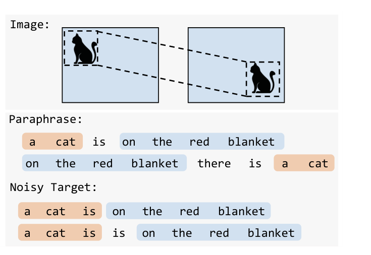
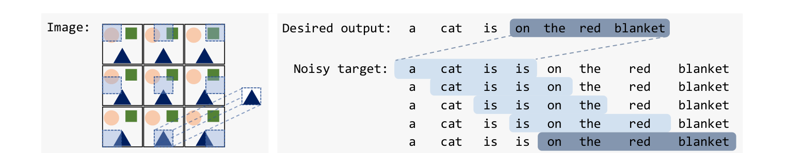
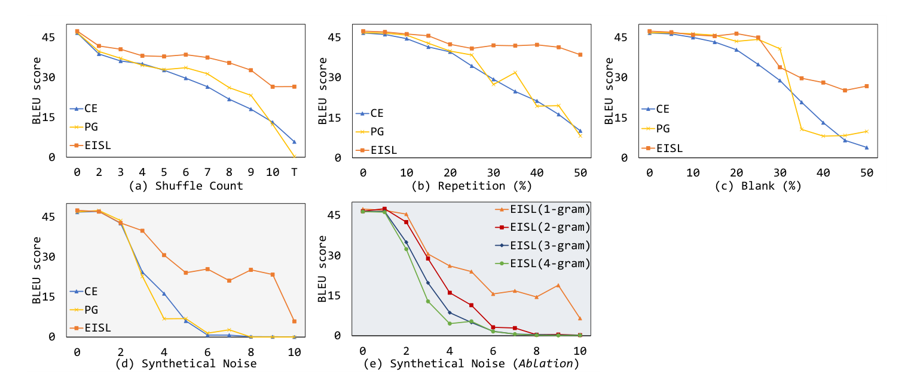

<div align="center">

# EISL

### Don't Take It Literally: An Edit-Invariant Sequence Loss for Text Generation

**A drop-in replacement for sequence cross-entropy that scores *n*-gram matches at every position instead of demanding a token-by-token copy of the target — so a model can learn from noisy, paraphrased, weakly-supervised or unordered targets. Cross-entropy is the special case n = target length.**

[](https://aclanthology.org/2022.naacl-main.150/)
[](https://arxiv.org/abs/2106.15078)
[](LICENSE)

[Guangyi Liu](https://guangyliu.github.io)<sup>1</sup>, Zichao Yang<sup>2</sup>, Tianhua Tao<sup>3</sup>, Xiaodan Liang<sup>4</sup>, Junwei Bao<sup>5</sup>, Zhen Li<sup>1</sup>, Xiaodong He<sup>5</sup>, Shuguang Cui<sup>1</sup>, Zhiting Hu<sup>6</sup>

<sup>1</sup>CUHK-Shenzhen · <sup>2</sup>Carnegie Mellon University · <sup>3</sup>Tsinghua University · <sup>4</sup>Sun Yat-sen University · <sup>5</sup>JD AI Research · <sup>6</sup>UC San Diego



</div>

---

## Why

Sequence cross-entropy (CE) maximises `log p(y*)` for one reference `y*` and treats every other
sequence — including paraphrases that share most of its *n*-grams — as equally wrong. That is
the right objective only when the reference is perfect. It is the wrong one when

* the target is **noisy** (web-crawled parallel data, repeated or dropped tokens, typos);
* only **weak supervision** exists (e.g. unsupervised style transfer, where the "target" is a
  back-translation or the input itself);
* generation order is **not predefined** (non-autoregressive decoding).

EISL borrows the idea that makes ConvNets translation-invariant: slide each reference *n*-gram
over every position of the candidate sequence and aggregate. Figure 2 of the paper shows CE
exploding as soon as a few edits are injected into the target while EISL barely moves.

<div align="center"></div>

## What the loss is

For the *i*-th reference *n*-gram `y*_{i:i+n}`, EISL minimises an upper bound on the negative
log of its expected number of occurrences in model samples:

```
L^EISL_{n,i}(θ) = − E_{y∼p_θ} [ (1/(T−n+1)) · Σ_{i'} log p_θ( y_{i':i'+n} = y*_{i:i+n} | y_{<i'} ) ]
L^EISL_n        = mean over i ;    L^EISL = Σ_n w_n · L^EISL_n      (w_n uniform up to n = 4 works well)
```

* **Convolution.** `log p(y_{i':i'+n} = y*_{i:i+n} | ·)` at all positions `i'` is exactly a 1-D
  convolution of the model's log-probability matrix (`V × T`) with the one-hot reference
  *n*-gram (`V × n`) as kernel — one `conv1d` call, negligible cost over CE.
* **Position selection.** Positions are re-weighted with a Gumbel-softmax over the *n*-gram's
  probability across positions, so the model learns *where* a reference *n*-gram belongs
  instead of spreading mass everywhere.
* **Generality.** With `n = T*` (the full target) the loss collapses to `− log p(y*)`, i.e. CE.
  The bound makes no assumption on `p(y)`, so it applies to autoregressive and
  non-autoregressive models alike; for autoregressive models the conditioning on model
  samples is approximated with one teacher-forced pass over the model's own greedy tokens.
* **Relation to BLEU.** BLEU also counts *n*-gram matches but is non-differentiable and needs
  RL; EISL is a differentiable log-likelihood-style objective over the same *n*-gram statistics.

**Keywords:** edit-invariant loss · *n*-gram matching loss · noisy target sequences · label noise
in seq2seq · weak supervision · non-autoregressive generation · convolution over sequences ·
alternative to cross-entropy / teacher forcing · machine translation · text style transfer.

---

## Results

**Machine translation with noisy targets** (Multi30k de→en, BART-base; BLEU on clean test).
Targets are corrupted with token shuffling, repetition, blanking, or all three; CE and policy
gradient collapse as noise grows, EISL degrades gracefully. On real noisy web data (WMT18 raw
de→en) the gap over CE widens as training data grows.

<div align="center"></div>

**Unsupervised style transfer** (Yelp sentiment; adding EISL to Tian et al. 2018):

| Model | Acc % | BLEU (input) | BLEU (human ref) | PPL |
|---|---|---|---|---|
| Hu et al. 2017 | 86.7 | 58.4 | – | 177.7 |
| Shen et al. 2017 | 73.9 | 20.7 | 7.8 | 72.0 |
| He et al. 2020 | 87.9 | 48.4 | 18.7 | 31.7 |
| Dai et al. 2019 | 87.7 | 54.9 | 20.3 | 73.0 |
| Tian et al. 2018 | 88.8 | 65.71 | 22.56 | 42.07 |
| **+ EISL (ours)** | 88.8 | **68.51** | **23.17** | **41.56** |

Human preference: EISL output judged better on 30.7 % of inputs vs. 22.0 % for the base model
(47.3 % tie).

**Non-autoregressive translation** (WMT14 en→de, test BLEU, first decoding iteration):

| Model | CE (KD) | **EISL (KD)** | CE (raw) | **EISL (raw)** |
|---|---|---|---|---|
| Vanilla-NAT | 17.9 | **22.2** | 9.12 | **15.46** |
| NAT-CRF | 21.88 | **22.43** | – | – |
| iNAT | 16.67 | **22.59** | – | – |
| LevT | 17.84 | **23.61** | 9.91 | **18.47** |
| CMLM | 17.12 | **23.05** | – | – |
| *Transformer-base (autoregressive)* | 27.48 | | | |

Against other fully non-autoregressive losses on CMLM (KD): Bag-of-ngrams 20.90, AXE 23.53,
**EISL 24.17**.

---

## Using EISL

### Stand-alone PyTorch (any model, HF `Trainer`, your own loop)

[`eisl_loss.py`](eisl_loss.py) is a dependency-free implementation of the loss:

```python
from eisl_loss import eisl_loss

log_probs = model(**batch).logits.log_softmax(-1)      # [B, T, V]
loss = eisl_loss(log_probs, batch["labels"],           # labels: [B, T*], pad_id
                 ngram=[1, 2, 3, 4], pad_id=tokenizer.pad_token_id)
```

For an autoregressive model, run the forward pass on the model's own greedy/sampled prefix
(or, as a cheap approximation, on the teacher-forced reference) — see the paper §3.2 and
[`EISL_trainer.py`](EISL_trainer.py) for a Hugging Face `Trainer.compute_loss` override.
Mixing with CE (`ce_factor`, `ngram_factor`) is often useful early in training.

### fairseq criterion (reproduces the paper)

```bash
cp EISL.py fairseq/fairseq/criterions/EISL.py
fairseq-train ... --criterion EISL --ngram 1,2,3,4 --ce-factor 0.0 --ngram-factor 1.0
```

`--ngram` accepts positive orders and non-positive offsets from the output length
(`-1` = length − 1, `0` = full length, i.e. CE). The vendored [`fairseq/`](fairseq) is the
snapshot (1.0.0a0) the experiments ran on, with the noisy-Multi30k preprocessing under
`fairseq/examples/translation`, run scripts, and the generated test-set outputs and
per-sentence BLEU under `fairseq/log/hypo`. See [`fairseq/README.md`](fairseq/README.md).

**Non-autoregressive MT:** [`NAT/README.md`](NAT/README.md).

> **Pretrained checkpoints.** The BART checkpoints for the noisy-Multi30k experiments were
> hosted on a university SharePoint that has been retired; they are no longer available. The
> NAT checkpoints are on the Google Drive linked from `NAT/README.md`. Everything else
> retrains from the scripts.

---

## Related work

EISL sits between three lines of work: **differentiable BLEU / n-gram objectives**
(Zhukov & Kretov 2017; Casas et al. 2018; Shao et al.'s bag-of-*n*-grams for NAT, 2020),
**alignment-based losses for non-autoregressive generation** —
[AXE](https://arxiv.org/abs/2004.01655) (Ghazvininejad et al., ICML 2020),
[OAXE](https://arxiv.org/abs/2106.05093) (Du et al., ICML 2021) and
[ngram-OAXE](https://arxiv.org/abs/2210.03999) (COLING 2022) — and **learning with noisy
labels / references** (loss truncation, Kang & Hashimoto 2020; student forcing). Unlike the
alignment losses, EISL needs no dynamic program and applies unchanged to autoregressive models;
unlike RL-with-BLEU, it is a likelihood-style objective with a closed-form gradient.

The same failure mode — token-level CE punishing every deviation from an imperfect reference —
is now being revisited for LLM post-training on noisy instruction data
(e.g. [Analyzing the Effect of Noise in LLM Fine-tuning](https://arxiv.org/abs/2604.12469), 2026;
[Fine-Tuning on Noisy Instructions](https://arxiv.org/abs/2510.03528), 2025); EISL is a
sequence-level, *n*-gram-aware alternative to the token-level robust losses those works consider.

---

## Citation

```bibtex
@inproceedings{liu-etal-2022-dont,
  title     = {Don't Take It Literally: An Edit-Invariant Sequence Loss for Text Generation},
  author    = {Liu, Guangyi and Yang, Zichao and Tao, Tianhua and Liang, Xiaodan and
               Bao, Junwei and Li, Zhen and He, Xiaodong and Cui, Shuguang and Hu, Zhiting},
  booktitle = {Proceedings of the 2022 Conference of the North American Chapter of the
               Association for Computational Linguistics: Human Language Technologies (NAACL)},
  pages     = {2055--2078},
  year      = {2022},
  address   = {Seattle, United States},
  publisher = {Association for Computational Linguistics},
  url       = {https://aclanthology.org/2022.naacl-main.150/},
  doi       = {10.18653/v1/2022.naacl-main.150}
}
```

## Acknowledgements

Built on [fairseq](https://github.com/facebookresearch/fairseq) (MIT). Noisy-target data
derive from [Multi30k](https://github.com/multi30k/dataset) and the WMT18 raw parallel corpus;
style-transfer data are the Yelp corpus of [Li et al. (2018)](https://github.com/lijuncen/Sentiment-and-Style-Transfer).
